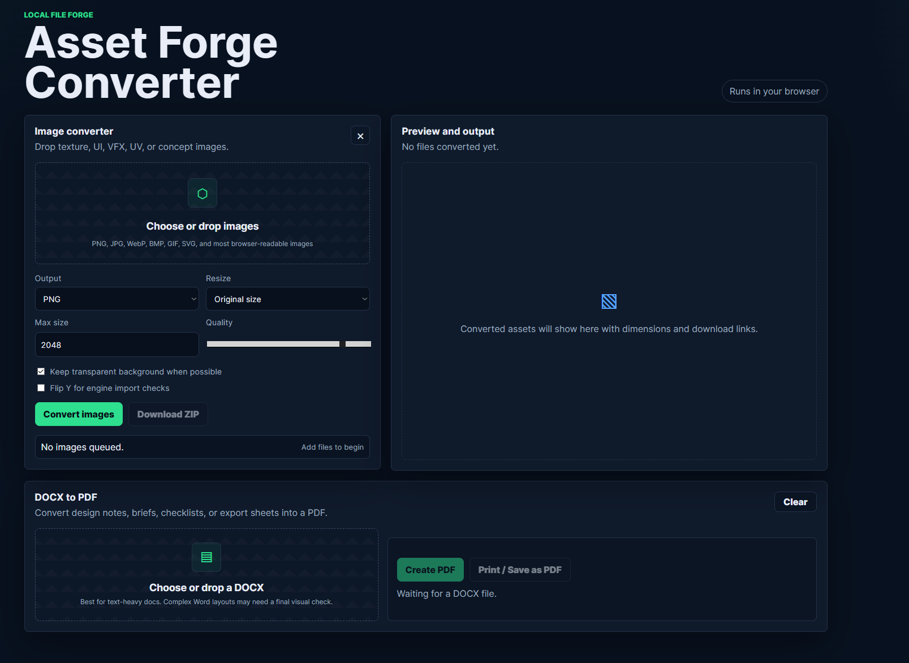

# Asset Forge Converter

Asset Forge Converter is a browser-based utility workspace for game developers, artists, and everyday file preparation. Convert and resize images, remove backgrounds, repair cutouts, and preview and download PDFs from DOCX files. File processing runs locally in the browser; no application backend is required.



*Earlier version of the interface. See the current app for the new background-removal and PDF controls.*

## Project documents

- [Roadmap](ROADMAP.md): proposed improvements, new utilities, and integration priorities.
- [Contributing](CONTRIBUTING.md): development workflow, testing, and useful bug reports.

## Quick start

Use Node.js 22 and npm for the development workflow used to verify this project. Python 3 is an optional local static server.

```powershell
npm.cmd ci
npm.cmd run build
python -m http.server 4173 --bind 127.0.0.1 --directory dist
```

Open [http://127.0.0.1:4173](http://127.0.0.1:4173). On macOS or Linux, use `npm` instead of `npm.cmd` and `python3` if needed. Stop the server with Ctrl+C. Serving `dist` publishes only the application files, not private development fixtures.

## What it does

- Converts images to PNG, JPEG, or WebP.
- Supports batch image uploads with individual downloads.
- Exports all converted images as a ZIP file.
- Resizes images to original size, a custom maximum size, or nearest power-of-two dimensions.
- Includes quality control for compressed formats.
- Preserves transparency when possible.
- Removes image backgrounds locally with an AI model and exports transparent PNGs.
- Offers solid-detail recovery and soft-edge modes, plus Restore/Erase brushes with zoom, undo, and reset.
- Can flip images vertically for engine import checks.
- Previews DOCX pages with their supported page sizes, margins, fonts, tables, headers, and footers.
- Shows the generated PDF pages and downloads that exact PDF with one click.
- Offers optional browser printing for selectable text.

## Why this exists

This tool is meant for asset prep while making games, especially when moving files between art tools, Blender, and game engines. It is useful for quick texture, UI, UV, VFX, and documentation conversions without opening a heavier editor.

## How to use it

### Image conversion

1. Open the site.
2. Drop one or more images into the Image converter area.
3. Choose the output format.
4. Pick a resize mode:
   - Original size keeps the source dimensions.
   - Nearest power of two is useful for engine texture workflows.
   - Custom max size scales large images down to a chosen maximum dimension.
5. Adjust quality if exporting JPEG or WebP.
6. Convert the images.
7. Download files one by one or export everything as a ZIP.

### DOCX to PDF

1. Drop a DOCX file into the DOCX to PDF area.
2. Click **Create PDF preview**.
3. Check the generated PDF pages. The preview is rendered from the actual PDF bytes using PDF.js.
4. Click **Download PDF** to save the same file without a print dialog. **Open PDF in new tab** also opens that file.

Direct export captures each rendered document page as a lossless PNG at up to 288 dpi and preserves its paper dimensions/orientation. It does not slice one long image into arbitrary pages. If a rendered page overflows, its content is proportionally fitted to the original paper and the preview reports the scale so you can check readability.

The renderer waits for embedded fonts before measuring tabs and capturing pages. It preserves run letter spacing, uses natural font metrics for automatic line spacing, and treats raw XML whitespace separately from explicit Word line breaks. Canvas text measurements use the document's own font context.

Downloaded PDFs contain page images, so their text is not selectable or searchable. For a text-preserving export, **Print (optional)** opens the browser print dialog: choose Save as PDF, use 100% scale, disable browser headers/footers, and enable background graphics. For resumes submitted to automated recruiting systems, prefer a text-preserving export.

### Background removal

1. Add images and enable **Remove image background (AI)**.
2. Choose **Keep solid details** for artwork/UI or **Soft edges** for hair, smoke, and glows.
3. Click **Remove backgrounds**. Output is always a transparent PNG, including when JPEG was previously selected.
4. Review the cutout on the checkerboard. Use **Refine cutout** for repairs, then **Apply changes**.
5. Download the result individually or in a ZIP.

**Keep solid details** boosts faint foreground opacity for artwork and UI; adjust **Detail recovery** to trade cleaner background removal for stronger thin parts. **Soft edges** preserves the AI's partial opacity for hair, smoke, and glows. Neither mode can infer every missing object in textures, UV maps, or effects.

Use **Refine cutout** to paint **Restore** from the original image or **Erase** unwanted pixels, with zoom, undo, and reset. **Apply changes** updates both the individual download and ZIP; Cancel discards the edits. Existing source transparency is preserved. GIF input exports a still first frame, not an animated cutout.

The first run downloads roughly 80 MB of model data plus the inference runtime from IMG.LY. Images are processed sequentially in a worker so the interface remains responsive. Cancel stops the worker; any completed images remain downloadable. Network/model errors are shown per file, and a failed image does not discard successful results.

## Privacy

The conversion work runs in the browser. Files are processed locally by the page instead of being uploaded to a custom server.
Background removal downloads public model/runtime assets from `staticimgly.com`; it does not upload your images. DOCX rendering uses bundled libraries and blocks external document resources. Serve the site over HTTPS or localhost for browser worker support.

## Current limitations

- DOCX preview uses `docx-preview`, not Microsoft Word's layout engine. It honors saved/explicit page breaks; automatic pagination and advanced layouts can differ. Review resumes before sending them.
- Complex Word layouts, custom fonts, floating images, and advanced formatting may not match Microsoft Word exactly.
- Fonts need to be installed on the device or embedded in the DOCX. For an exact Word-rendered PDF, export directly from Word.
- Direct PDF download prioritizes visual appearance and contains page images; optional print/Word export is available when selectable text is required.
- AI cutouts may need touch-ups around hair, fine edges, or multiple subjects. Large images need more device memory.
- Detail recovery strengthens partially visible pixels; it cannot automatically recover parts assigned zero opacity. Restore can recover those parts from the original, and can also restore background if painted outside the subject.
- GIF output is a still first frame. Animated GIF/WebP export is not implemented.
- Nearest power-of-two sizing rounds width and height independently and can change aspect ratio. Use Custom max size to preserve the original proportions.
- Browser image export is limited to formats the browser can read and write through canvas, so PNG, JPEG, and WebP are the main output formats.
- This first version does not include game-engine-specific presets beyond power-of-two sizing and Y-flip support.

## Project structure

```text
src/                       # Worker, cutout editor, and PDF modules
scripts/                   # Build and pinned renderer compatibility patches
tests/                     # Automated checks and browser integration harness
dist/
  index.html               # Editable application markup
  styles.css               # Editable application styles
  app.js                   # Editable application controller
  background-worker.js     # Generated worker bundle
  cutout-tools.js           # Generated editor/mask bundle
  pdf-tools.js              # Generated PDF bundle
  vendor/                  # Copied libraries, PDF worker, and license files
package.json
package-lock.json
ROADMAP.md
CONTRIBUTING.md
OPEN_SOURCE.md
```

The site is static and can be served from the `dist` folder.

## Development

```powershell
npm.cmd ci
npm.cmd run build
npm.cmd test
```

The build copies pinned DOCX/ZIP libraries and the PDF.js worker, bundles background-removal, cutout, and PDF tools into `dist/`, and updates asset version hashes in the HTML. The checked-in `dist` remains directly deployable to static hosts. Edit `dist/app.js`, `dist/index.html`, and `dist/styles.css` directly; edit generated bundles through their `src/` modules and rebuild. Renderer fixes live in `scripts/patch-docx.mjs` and `scripts/patch-html2canvas.mjs`, not in `node_modules`.

`tests/browser.html` provides a browser integration harness for a synthetic resume fixture. To use it, temporarily serve the repository root on localhost and open `/tests/browser.html`. See [Contributing](CONTRIBUTING.md) for manual checks and test limitations.

PDF export uses jsPDF 4.2.1 and html2canvas 1.4.1 (MIT); inline preview uses PDF.js 5.4.624 (Apache-2.0). The PDF export tests use a real PDF writer and reader to verify page dimensions and orientation, with only browser rasterization stubbed.

Background removal uses [IMG.LY background-removal](https://github.com/imgly/background-removal-js) 1.7.0 (AGPL-3.0; license in `dist/vendor/background-removal-LICENSE.md`). DOCX rendering uses [docx-preview](https://github.com/VolodymyrBaydalka/docxjs) 0.4.1 (Apache-2.0), ZIP export uses JSZip 3.10.1 (MIT), and inference uses ONNX Runtime Web 1.21.0 (MIT). Dependency sources and versions are recorded in `package-lock.json`; application/worker source is included in this repository.

## License status

A project-level license has not yet been selected. Third-party components retain their own licenses; their inclusion does not grant a license for the project's original code. See the [open-source plan](OPEN_SOURCE.md) before redistributing or preparing a public release.

## Deployment

This project is deployed as a static site from the `dist` folder.

For GitHub Pages configured to serve the repository root, `index.html` redirects to `dist/`, preserving the existing site URL. The GitHub Actions workflow also supports deploying `dist` directly when Pages is configured to use GitHub Actions.

For OpenAI Sites, keep `.openai/hosting.json` so the existing Site project is updated instead of creating a new one.

If deploying with another static host, use `dist` as the publish directory.

## Local preview

From the project folder, run:

```powershell
python -m http.server 4173 --bind 127.0.0.1 --directory dist
```

Then open:

```text
http://localhost:4173
```
